<!-- ═══════════════ HEADER ═══════════════ -->
 <a href="https://git.io/typing-svg">  </a>

<br/><br/>

   <br/>      

<br/><br/>

<a href="https://www.linkedin.com/in/YOUR-LINKEDIN-USERNAME"></a> <a href="mailto:YOUR-EMAIL@example.com"></a> <a href="https://github.com/mhsahel?tab=repositories"></a>

<br/><br/>

   </div>

---

## 👋 About Me

```python

I'm a student at AIUB on a mission to become an AI / ML Engineer. I like taking raw, messy data and shaping it into models that actually answer a question, and I care as much about clean, reproducible workflows as I do about accuracy scores.

Right now I'm building a portfolio of end-to-end projects in healthcare and behavioral data, learning deep learning with PyTorch, and growing through my Machine Learning internship at CodeAlpha. Every project here is a step on that path, and I'm always happy to learn from people who are further along.
```

<table>
<tr>
<td>

🔭 **Currently working on** — end-to-end ML projects with clean, industry-style pipelines

🌱 **Currently learning** — clustering, neural networks (PyTorch), model tuning & evaluation

🎓 **Preparing for** — DataCamp Data Scientist certification

🤝 **Looking to collaborate on** — ML / data science projects & study groups

💼 **Open to** — ML / AI internships and junior opportunities

⚡ **Fun fact** — I enjoy turning a messy CSV into a working model more than I should 😄

</td>
</tr>
</table>

---

## 🛠️ Tech Stack

<div align="center">

### 🧠 AI / ML & Data


### 💻 Languages, Databases & Tools


</div>

| Area | What I use |
|------|-----------|
| 🤖 **Machine Learning** | Scikit-learn, Pipelines, ColumnTransformer, Logistic/Linear Regression, Decision Trees, KNN, Random Forest, KMeans, RandomizedSearchCV |
| 🧬 **Deep Learning** | PyTorch, Neural Networks, Fashion-MNIST |
| 📊 **Data Analysis** | Pandas, NumPy, Matplotlib, Seaborn, EDA, Feature Engineering |
| 🗄️ **Databases** | SQL, SQL Server |
| 🧱 **Software** | C#, WinForms, 3-layer architecture (UI / Repository / Model) |
| 🔧 **Workflow** | Git, GitHub, Jupyter Notebook, VS Code |

---

## 🚀 Featured Projects

<table>
<tr>
<td width="50%" valign="top">

### 🧠 Mental Health Score Prediction
End-to-end regression project: EDA, cleaning, sklearn pipelines, Linear Regression baseline, and a Random Forest tuned with `RandomizedSearchCV`.


[**View Repository →**](https://github.com/mhsahel/mental-health-score-prediction)

</td>
<td width="50%" valign="top">

### 🩺 Chronic Kidney Disease Classification
Classification on the messy, real-world UCI CKD dataset, following an industry-style workflow: cleaning, imputation, modeling, evaluation.


[**View Repository →**](https://github.com/mhsahel?tab=repositories)

</td>
</tr>
<tr>
<td width="50%" valign="top">

### 🍬 Diabetes Prediction (Capstone)
Full ML workflow: EDA, cleaning, feature engineering, encoding, scaling, and comparison of Logistic Regression, Decision Tree, KNN and Random Forest using precision, recall and F1.


[**View Repository →**](https://github.com/mhsahel?tab=repositories)

</td>
<td width="50%" valign="top">

### 👗 StyleAI: Fashion-MNIST Classifier
Neural network image classifier built in PyTorch on Fashion-MNIST: data loading, model design, training loop and evaluation.


[**View Repository →**](https://github.com/mhsahel?tab=repositories)

</td>
</tr>
<tr>
<td colspan="2" valign="top">

### 💳 CodeAlpha ML Internship Tasks
Credit Scoring Model (loan default prediction with debt-burden features like `loan_to_income` and `payment_to_income`) and Disease Prediction from Medical Data.


</td>
</tr>
</table>

> 📌 More projects are on the way. Check the [repositories tab](https://github.com/mhsahel?tab=repositories) for the latest.

---

## 🗺️ My Learning Roadmap

```mermaid
graph LR
    A[🐍 Python & SQL] --> B[📊 EDA & Data Cleaning]
    B --> C[🤖 Classical ML]
    C --> D[🧠 Deep Learning]
    D --> E[🚀 End-to-End Projects]
    E --> F[☁️ MLOps & Deployment]
    F --> G[🎯 AI Engineer]
    style A fill:#0A66C2,color:#fff
    style B fill:#0A66C2,color:#fff
    style C fill:#0A66C2,color:#fff
    style D fill:#EE4C2C,color:#fff
    style E fill:#EE4C2C,color:#fff
    style F fill:#555,color:#fff
    style G fill:#2ea44f,color:#fff
```



| Stage | Status |
|-------|--------|
| Python, Pandas, NumPy, Matplotlib | ✅ Done |
| Scikit-learn & ML pipelines | ✅ Done |
| Clustering & model tuning | 🔄 In progress |
| Neural Networks with PyTorch | 🔄 In progress |
| DataCamp Data Scientist certification | 🎯 Preparing |
| MLOps, deployment (FastAPI, Docker) | ⏳ Up next |

---

## 📊 GitHub Stats

<div align="center">


<br/>


<br/>


</div>

---

## 🏆 Highlights

- 💼 **Machine Learning Intern** at **CodeAlpha** (Oct 2026)
- 🎓 Student at **AIUB**, building toward an AI engineering career
- 📈 Building a portfolio of **end-to-end, recruiter-ready ML projects**
- 🎯 Working toward the **DataCamp Data Scientist** certification
- 🎨 Created a 3D interactive visualization of scikit-learn's `ColumnTransformer`

---

## 🤝 Let's Connect

<div align="center">

<a href="https://www.linkedin.com/in/YOUR-LINKEDIN-USERNAME">
  
</a>
<a href="mailto:YOUR-EMAIL@example.com">
  
</a>
<a href="https://github.com/mhsahel">
  
</a>

<br/><br/>

💬 *Ask me about:* **Machine Learning, scikit-learn pipelines, PyTorch basics, and breaking into AI as a student**

<br/>

> *"The best way to learn machine learning is to build, break, and rebuild."*

<br/>


</div>
